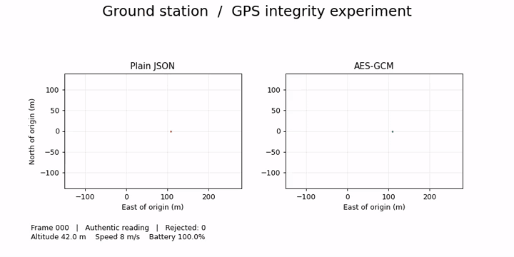
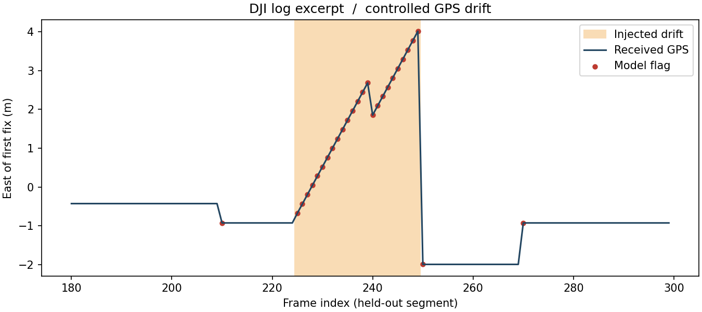

# FlightLab

FlightLab is a Python project I put together to explore a question I had about drones: what happens if the information sent to a ground station is wrong or has been changed?

I made three small experiments. They use simulated data or a public sample log, **not a real drone**. This is a learning project, not flight-ready security software.



## What I tried

### 1. Changing GPS data (`telemetry.py`)

I simulated a drone sending its location, altitude, speed and battery level. Then I changed part of the GPS data while it was being sent.

The program compares two receivers:
- A basic receiver that reads the JSON data without checking whether it was changed.
- A receiver using AES-GCM authentication, which rejects the edited message.

The animation shows the difference. The edited position appears on the basic receiver, but the authenticated receiver rejects that packet.

One thing I learned is that checking the integrity of a message matters, even if the data itself looks normal. This doesn't solve every GPS security problem, especially if incorrect data enters the system before encryption.

### 2. Testing a small packet parser (`fuzzer.py`)

I made a simple three-byte format for altitude readings and compared two versions of a parser.

The first version assumes the input is correct. The second checks the packet length, identifier and altitude range before accepting it.

I generated test inputs including missing bytes, extra bytes and invalid values. The results are in [fuzz-report.md](fuzz-report.md).

This helped me understand why validating input is important. A program shouldn't assume every message it receives is valid.

### 3. Finding unusual movement (`anomaly.py`)

For this experiment, I used a short public DJI-format sample log and added a small artificial change to part of the GPS readings.

I used Python and Isolation Forest to flag unusual frame-to-frame movement.



I originally tried using absolute positions, but that flagged too many normal frames. Comparing changes between frames worked better on this sample. That doesn't mean it would work on every flight, so I'd want to test it on more data.

## How to run it

I tested the project with Python 3.12. On Windows, open a terminal in the project folder and run:

```powershell
py -3.12 -m venv .venv
.\.venv\Scripts\python -m pip install -r requirements.txt
.\.venv\Scripts\python telemetry.py
.\.venv\Scripts\python fuzzer.py
.\.venv\Scripts\python anomaly.py
```

The first script opens a live graph. Close the graph window to stop it. The other scripts generate a test report and a chart.

## Tools I used

- Python
- Matplotlib and NumPy for data and graphs
- `cryptography` for AES-GCM
- scikit-learn for Isolation Forest

## What I'd improve next

- Add automated tests for the GPS receiver and packet parser.
- Try different GPS changes to see when the anomaly detector misses them.
- Make a small web dashboard so someone can view the results in a browser.

I used AI assistance while building and documenting parts of this project. I'm continuing to study the code and test changes myself so I can explain how each part works.

## Data credit

The sample used for the anomaly experiment comes from this [public DJI-format SRT file](https://github.com/7amzaGH/UAV-SAR-Human-Detection-and-Geolocation/blob/3ca4b5ce1586e46d1d6de7d1da15efb9daa04fc8/data/Demo_15m90d_Data.srt). The GPS changes in my experiment are simulated.
