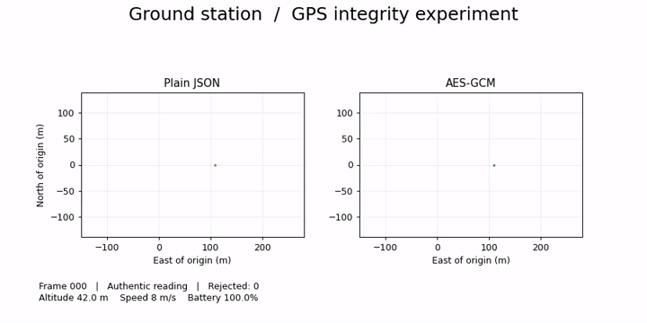
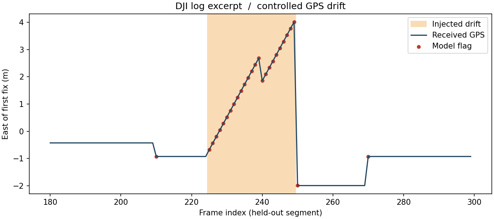

# FlightLab
Three local Python experiments on how a ground station handles misleading readings. 



During frames 26–39, an interceptor changes one longitude digit. Watch the plain receiver draw the false track while the authenticated receiver leaves a gap. [Open the MP4](comparison.mp4).

The sender, interceptor and receiver run in one process with separate packet-handling steps.

## Run on Windows
Install Python 3.12, unzip the folder and open a terminal inside FlightLab.
```powershell
py -3.12 -m venv .venv
.\.venv\Scripts\python -m pip install -r requirements.txt
.\.venv\Scripts\python telemetry.py
.\.venv\Scripts\python fuzzer.py
.\.venv\Scripts\python anomaly.py
```
Close the plot window to stop the live stream. To regenerate the movie, install FFmpeg on PATH and run telemetry.py with --video.

## 1 · Trusting a position
The left receiver parses plain JSON. During frames 26–39 the interceptor alters a digit of longitude. The plotted position shifts. On the right, AES-GCM authenticates every encrypted reading. The same byte flip fails verification and leaves a gap in the accepted track. A fresh random 128-bit key starts each run and the increasing packet number provides a unique nonce under that key. The receiver authenticates before checking its sequence high-water mark. This strict ordering also drops delayed packets. The simulation measures ground-station display integrity. Flight controls, radio interference, key provisioning and sensor-side GPS spoofing are outside this experiment.

## 2 · Breaking a parser
The miniature three-byte altitude protocol makes parser behavior easy to inspect. The legacy parser accepts any magic byte and altitude, and unpacking a short or long packet raises an exception. The patch checks length, magic byte and range before returning a reading. Compare both on exactly the same inputs in [the generated report](fuzz-report.md). No actual aircraft network is involved.

## 3 · Detecting suspicious motion


The first 180 frames train the Isolation Forest. The final 120 provide a chronological test. We treat the original excerpt as the reference and insert a known eastward drift in 25 test frames. The plot marks this interval in tan and model flags in red. The model sees absolute frame-to-frame changes in east position, north position and altitude. These features suit a short, mostly stationary excerpt. The first difference within each segment is set to zero.

| Feature choice | Drift frames flagged / 25 | Other frames flagged / 95 |
|---|---:|---:|
| Initial baseline with absolute position | 25 | 95 |
| Frame-to-frame changes | 25 | 3 |

The baseline flagged ordinary movement to a new location. We revised the features after inspecting this result, so the second row is exploratory. An unseen flight would give a better measure of generalization. Labels describe only the injected changes. The experiment cannot assign a cause to an unknown anomaly.

Data: 300 consecutive frames (first 2,400 lines) of the [public DJI-format SRT sample at a pinned commit](https://github.com/7amzaGH/UAV-SAR-Human-Detection-and-Geolocation/blob/3ca4b5ce1586e46d1d6de7d1da15efb9daa04fc8/data/Demo_15m90d_Data.srt). log.csv contains latitude, longitude, heading and relative altitude in source order. Values are as published. Independent verification of the recording is outside this exercise.

## Make it your experiment
Predict what happens when an attacker slowly changes a GPS reading before it is encrypted. Try a smaller drift and save the new confusion counts. Record your prediction, your code change and one result that surprised you before using the project in an application.
